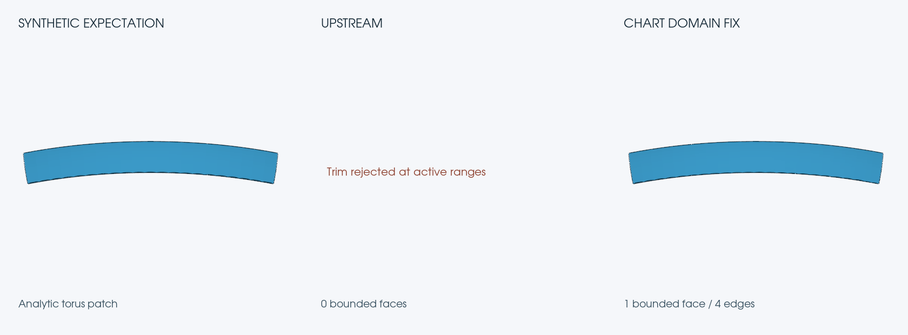

# Synthetic CATIA chart-domain comparison

The main fixture is an 812-byte hand-encoded decoder test with one torus
sheet and four edges. The Python generator uses documented native records.
The fixture, generator, render script, and exported STEP files are licensed
Apache-2.0. The image is licensed CC-BY-4.0.

## Comparison

The first panel is an independent analytic torus patch constructed in
OpenCascade from the fixture's center, radii, and trim angles.
The middle panel records upstream's zero exported bounded faces.
The last panel renders the actual STEP export from the fixed decoder.

OpenCascade imports and tessellates the exported STEP. VTK renders the
geometry off screen with the same orthographic camera for all three panels.
This is a generated geometry comparison.

## Reproduce

Run `python3 generate.py` to recreate the synthetic fixtures.
Convert `torus-trim-domains.catpart` with upstream commit
`9e6b4ebc58432204e2ac8ec82ba5db19874141d4` to `before.step`,
then with fix commit `3204a445095a9a1c3f0b2c86208a91dbdbb773a9`
to `after.step`. The conversions report native metadata losses and
write their STEP output. The first export contains zero ADVANCED_FACE
entities and the second contains one.

Install Python bindings for OpenCascade (`OCP`) and `vtk`, then run
`python3 render_comparison.py` to recreate `comparison.png`.
The fixed STEP passes `cadmpeg check` with zero errors and warnings.
